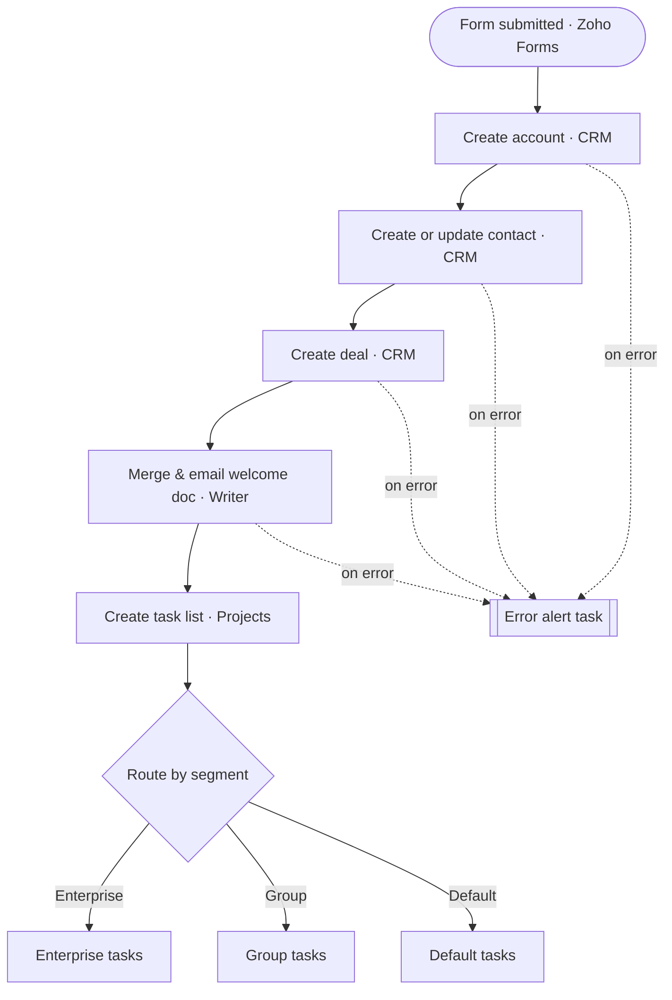

# Client Onboarding Automation

> One intake form turns a new client into a CRM account, a deal, a welcome document and a full Projects task plan.

**Live case study:** [https://mnkiswan.github.io/client-onboarding-automation/](https://mnkiswan.github.io/client-onboarding-automation/) · **Portfolio:** [zoho-flow-portfolio](https://mnkiswan.github.io/zoho-flow-portfolio/)

**Trigger:** A new Zoho Forms intake submission (real-time)  
**Zoho apps:** Zoho Forms, Zoho CRM, Zoho Writer, Zoho Projects

## Flow

## Steps

1. **Intake form is submitted** (Zoho Forms): A client fills in one standard form. Every new client arrives in the same shape, so nothing has to be chased by email.
2. **Create the account in CRM** (Zoho CRM): Creates the company account record. The rest of the flow hangs off this record.
3. **Create or update the contact** (Zoho CRM): Creates the person, or updates them if they already exist, so repeat clients don't get duplicates.
4. **Create the deal** (Zoho CRM): Opens a deal so the sales pipeline shows the new client from the first minute.
5. **Merge and email the welcome document** (Zoho Writer): Fills a Writer template with the client's details and emails it. Every client gets the same professional pack.
6. **Create the task list in Projects** (Zoho Projects): Creates the delivery task list for this client.
7. **Route by client segment** (Decision): Enterprise, Group or Default. Each segment gets its own set of onboarding tasks, so enterprise work isn't handled like a small account.
8. **Create the segment's tasks and subtasks** (Zoho Projects): The right task plan is created for the segment, with subtasks, and assigned for kickoff.

## The problem

Intake came in by email and phone, in different formats. Someone then re-typed it into the CRM, wrote a welcome document from scratch, and built the kickoff tasks by hand. Every new client repeated the same three hours of admin.

## Business impact

- **One intake**: Every client is captured once, in the same structure. Nothing is re-typed.
- **Delivery starts faster**: The Projects task plan exists as soon as the form is submitted, not after someone finds time for it.
- **Forgotten steps**: Account, contact, deal, document and tasks are created in one run, in order, every time.
- **Failures are caught**: The error branch sends an alert task when a CRM or Writer step fails, so a broken run shows up instead of disappearing.

---
Part of the [Zoho Flow portfolio](https://github.com/mnkiswan/zoho-flow-portfolio).
